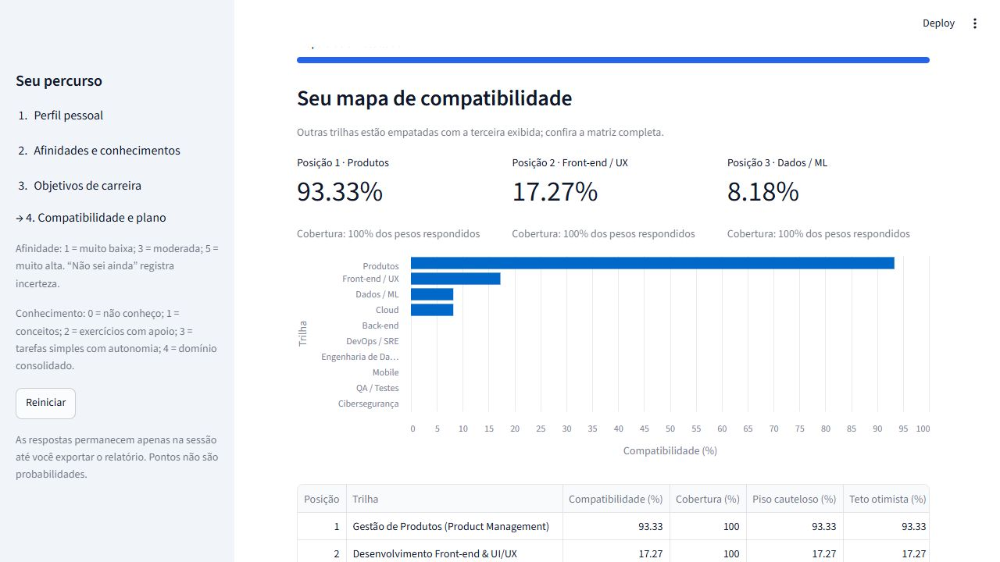

# Consultor Avançado de Carreiras em TI — Etapa 2

Trabalho de **Inteligência Artificial**, Ciência da Computação — UNIPAC Barbacena.

Sistema especialista com **motor próprio de soma ponderada**, conhecimento externo em JSON e interface Streamlit em etapas. Analisa afinidades graduais, apresenta as dez trilhas e o Top 3, identifica lacunas para um referencial Júnior e gera um plano de estudos e portfólio.

## 1. Instalar e executar

**Python 3.12 recomendado**, por ser o ambiente validado. O código utiliza Python 3.10 ou superior; o pip seleciona as dependências compatíveis com o interpretador dentro dos intervalos declarados. Não foram executados testes nas demais versões.

Extraia o ZIP e abra a pasta que contém `iniciar.py` e este README. No PowerShell:

```powershell
py -3.12 -m venv .venv
.\.venv\Scripts\python.exe -m pip install -r requirements.txt
.\.venv\Scripts\python.exe iniciar.py
```

No **PyCharm**, abra esta pasta, selecione `.venv\Scripts\python.exe` como interpretador, instale as dependências e execute **`iniciar.py` pelo botão Run**. Executar `app.py` diretamente também delega ao iniciador. Nas próximas execuções, não é preciso reinstalar os pacotes.

Em Linux/macOS:

```bash
python3 -m venv .venv
.venv/bin/python -m pip install -r requirements.txt
.venv/bin/python iniciar.py
```

Acesse o endereço informado pelo terminal, normalmente `http://localhost:8501`. Mantenha o servidor ativo e pressione Ctrl+C para encerrar. Alternativa no ambiente ativado: `python -m streamlit run app.py`. Se a porta estiver ocupada, acrescente `--server.port 8502` a esse comando. Se ocorrer `No module named ...`, instale as dependências com o mesmo interpretador usado na execução.

## 2. Utilizar

1. **Perfil pessoal:** informe afinidades por negócio, comunicação e pesquisa.
2. **Afinidades técnicas:** avalie de 1 a 5 as demais dimensões. Na aba **O que já consigo fazer**, marque as competências conhecidas e seu nível de 1 a 4; as não marcadas ficam em 0. “Não sei ainda” nas afinidades representa uma resposta desconhecida.
3. **Objetivos:** escolha seu objetivo e de 1 a 40 horas semanais de estudo.
4. **Resultado:** consulte o Top 3, a matriz das dez trilhas e escolha a carreira que deseja explorar. Veja gaps, sequência de estudos, certificação opcional e projeto para o GitHub. Exporte o relatório Markdown ou o diagnóstico JSON.

Você pode voltar às etapas para revisar respostas. Editar invalida o resultado anterior; reiniciar limpa a sessão. O aplicativo não grava respostas em cadastro. Os percentuais de afinidade e de atendimento ao referencial Júnior são indicadores diferentes; nenhum deles comprova aptidão, senioridade ou chance de contratação.

## 3. Estrutura da entrega

```text
Entrega_Etapa_2_Carreiras_TI/
├── README.md
├── iniciar.py                    Início pelo PyCharm/terminal
├── app.py                        Wizard Streamlit e gráficos
├── requirements.txt              Dependências de execução
├── requirements-dev.txt          Dependências de testes
├── pytest.ini
├── validar_personas.py           Dez perfis de validação
├── SHA256SUMS.txt                Integridade dos arquivos
├── .gitignore
├── .streamlit/config.toml
├── base/regras_carreiras.json     Pesos, penalidades, competências e projetos
├── consultor/
│   ├── __init__.py
│   ├── base.py                   Carregamento e validação da base
│   ├── motor.py                  Compatibilidade e incerteza
│   ├── roadmap.py                Gaps, dependências e cronograma
│   └── relatorio.py              Exportação legível
├── dados/personas.json
├── exemplos/                     Perfil analítico e diagnóstico reproduzível
├── docs/
│   ├── relatorio_academico.md
│   ├── matriz_decisao.md
│   └── validacao.md
└── tests/                        Motor, roadmap, JSON e interface
```

O motor não possui listas de carreiras, pesos ou tecnologias embutidos: essas informações são carregadas do JSON. É possível alterar os pesos e regras externas sem modificar o Python. A base é validada a cada carregamento; ciclos de pré-requisitos e referências inválidas são rejeitados.

## 4. Método de cálculo

Para resposta conhecida `r` em 1–5, normaliza-se `x = (r - 1) / 4`. Para cada trilha:

```text
base (%) = 100 × soma(peso × x) / soma dos pesos da trilha
compatibilidade (%) = limitar(base - penalidades, entre 0 e 100)
```

Penalidades são descontos em **pontos percentuais**, definidos por condições no JSON. Respostas desconhecidas não somam contribuição nem disparam penalidades. A cobertura informa a proporção dos pesos respondidos. Piso cauteloso e teto otimista delimitam cenários de preenchimento das respostas desconhecidas, sem interpretação estatística.

Os percentuais são independentes: várias trilhas podem ter aderência alta e eles não precisam somar 100%. Empates exatos compartilham a posição; diferenças de até 1 ponto percentual são sinalizadas como próximas. Um desempate por ID estabiliza a exibição, sem indicar mérito. O Top 3 mostra três entradas e informa se há outras empatadas no corte. Com cobertura insuficiente ou ausência de sinal positivo, a indicação fica explicitamente provisória.

O conhecimento atual não reduz a afinidade: ele é utilizado separadamente para calcular gaps. O roadmap remove competências já atendidas, acrescenta pré-requisitos e os ordena antes dos estudos dependentes. O plano usa horas semanais para estimar semanas. Pesos, limiares, níveis-alvo e estimativas são decisões educacionais documentadas, sem calibração externa.

Veja a [matriz de decisão](docs/matriz_decisao.md) e o [relatório acadêmico](docs/relatorio_academico.md).

## 5. Repetir a validação

```powershell
.\.venv\Scripts\python.exe -m pip install -r requirements-dev.txt
.\.venv\Scripts\python.exe validar_personas.py
.\.venv\Scripts\python.exe -m pytest -q
```

Em Linux/macOS, substitua o executável por `.venv/bin/python`.

**Resultados: 71 testes aprovados e 10/10 personas aprovadas.** Há testes de perfis mistos, empates, extremos da escala, dados desconhecidos, penalidades cruzadas, limites de incerteza, entradas inválidas, bases malformadas, dependências, exportação e navegação. Foi conferido no navegador um fluxo completo com perfil de teste de negócios/produto. Os detalhes estão no [relatório de validação](docs/validacao.md).

As personas são fictícias e foram construídas a partir da própria base: os testes demonstram consistência interna, sem comprovar precisão vocacional em usuários externos.

## 6. GitHub e entrega

O pacote está pronto para versionamento. Publique os arquivos desta pasta no repositório da atividade, preservando a Etapa 1 em uma pasta ou versão identificada. Não inclua `.venv`, caches, credenciais ou respostas pessoais. Confira se o professor possui acesso ao repositório e entregue o link no canal indicado.

Esta entrega foi preparada localmente; nenhuma publicação remota foi feita automaticamente.

## 7. Referências

- Enunciado fornecido: *Trabalho Etapa 2.pdf*, Inteligência Artificial, UNIPAC Barbacena, 22/10/2026.
- [Streamlit: AppTest](https://docs.streamlit.io/develop/api-reference/app-testing/st.testing.v1.apptest).
- [Streamlit: estado de sessão](https://docs.streamlit.io/develop/api-reference/caching-and-state/st.session_state).
- Certificações: links oficiais disponíveis no JSON e no plano gerado. Conferidos em 27/10/2026. Materiais de preparação podem ser gratuitos; exames podem envolver custos. Certificação não é requisito obrigatório do referencial Júnior utilizado.

## 8. Captura de execução

Exemplo de perfil de teste com interesse em negócios, comunicação e pesquisa:


